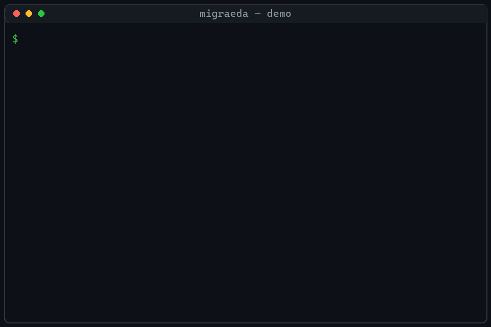

# MigraEDA

**Two-way conversion between JLCEDA and Altium Designer, with closed-loop verification: pin-by-pin net checks on the schematic, and board outline, tracks, vias, and copper compared on the PCB — whatever got miswired or dropped is listed on the spot, not discovered after the boards come back from the fab.**

[中文](README.md)

<p align="center">
  <a href="LICENSE"></a>
  <a href="https://www.python.org/downloads/"></a>
  <a href="https://pypi.org/project/migraeda/"></a>
  <a href="https://github.com/Apollo-lwx/MigraEDA/actions/workflows/ci.yml"></a>
  <a href="https://github.com/Apollo-lwx/MigraEDA"></a>
</p>

| | |
|---|---|
| Repository | [github.com/Apollo-lwx/MigraEDA](https://github.com/Apollo-lwx/MigraEDA) |
| Install | `pip install migraeda` (Python 3.10+, single pure-Python runtime dependency: olefile) |
| License | [MIT](LICENSE) |
| Version | 0.1.0 |

## Why this exists

Moving a board between JLCEDA and Altium, the official import/export reports "success". In practice:

- Symbols collapse into boxes
- Power ports decay into ordinary nets
- Net names get silently rewritten
- Footprint mapping fails
- Tracks, vias, and copper pours quietly come up short on the PCB

**None of this comes with a warning.** Nobody really diffs a 200-part board across two EDA windows. So a debug header ends up with GND and +5V swapped, a fuse moves from live to neutral, a diode gets drawn backwards — and all of it shows up after the boards come back from the fab.

MigraEDA's approach is simple: **write the file, immediately parse it back, and compare it against itself.** Schematics are checked pin by pin as `ref.pin`; the PCB is rigidly aligned first, then compared on board outline, component placement, pad positions, vias, and per-net copper statistics. A mismatch is printed line by line and the process exits 2, so CI stops the job. Schematics, PCB, and libraries are all in scope.

## See it in 30 seconds



```bash
migraeda convert board.eprj --to ad
```

```text
direction: eprj -> ad-ascii-schdoc
written: .migraeda/board.SchDoc
loop-verify: common_pins=367 mismatched=0 nets_matched=115
```

`mismatched=0` means pin connectivity matches the source exactly. Any mismatch is printed as `ref.pin` and the exit code is 2.

The PCB gets the same treatment — not just "it opens", but tracks, vias, and pours are counted and their geometry checked:

```bash
migraeda convert board.eprj --to adpcb
```

```text
direction: eprj-pcb -> ad-ascii-pcbdoc
source: 203 components, 1420 pads, 3560 tracks, 412 vias, 28 pour polygons
written: .migraeda/board.PcbDoc
fidelity-verify: PASS (pins 1420/1420, tracks 3560/3560, vias 412/412, polygons 28/28, geom PASS)
```

And when a conversion really does miswire a net — say the debug header's GND and +5V got swapped — the output looks like this:

```text
loop-verify: common_pins=367 mismatched=2 nets_matched=115
  mismatch: J3.2 src='GND' out='+5V'
  mismatch: J3.3 src='+5V' out='GND'
```

Exit code 2. Wired into CI, that step blocks everything downstream — a bad file never leaves the pipeline, so it never reaches the fab.

## Who it's for

- You drew the board in JLCEDA, but the fab / customer / teammate needs Altium files (or the other way round)
- Your team mixes JLCEDA and Altium, and you want proof that two files are the same design
- You used the official importer and want an independent check before handing files over
- You want "did the conversion drop a net" enforced in CI instead of by eye

## How it differs from the official importer

Conversion and verification run in the same command. The output is parsed with the same reader — pin by pin on schematics, track/via/copper geometry on PCB — and graded PASS / WARN / FAIL.

| | Official import / export | MigraEDA |
|---|---|---|
| Result | A dropped net stays quiet | Pin-level closed loop, down to `ref.pin` |
| Review | Two EDA windows, side by side | Markdown report, exit codes 0 / 1 / 2 |
| Coverage | Mostly schematics | Schematic + PCB (tracks, vias, copper) + libraries (symbols, footprints) |

## Key features

- **Two-way conversion**: JLCEDA `.eprj` ↔ Altium `.SchDoc` / `.PcbDoc`; the ASCII output opens directly in Altium Designer
- **Pin-level closed loop for schematics**: the output is re-parsed and checked pin by pin as `ref.pin`, with every mismatch listed
- **Geometry-level closed loop for PCB**: board outline, component placement, pad positions, via count and positions, and per-net track length and copper statistics — rigidly aligned before comparison, with adjustable tolerance
- **Three independent checks**: conversion inner loop, two-file comparison, and an A→B→A' round trip
- **CI-friendly**: exit codes PASS = 0 / WARN = 1 / FAIL = 2, reports are plain Markdown you can archive as build artifacts
- **Lean and local-only**: a single pure-Python runtime dependency (olefile), no account, no upload — design files never leave your machine
- **MCP server**: a built-in stdio MCP server, callable from clients such as Cursor and WorkBuddy

## Formats

| Format | Read | Write | Notes |
|--------|------|-------|-------|
| JLCEDA `.eprj` | Schematic, PCB (docType=3), embedded libraries | Schematic, PCB, library package | SQLite project. No official client required to parse |
| Altium `.SchDoc` | Binary and ASCII | ASCII | Multi-part and multi-mode symbols use the active part and mode |
| Altium `.PcbDoc` | Binary and ASCII | ASCII | Pads, vias, tracks, arcs, pours, board outline |
| Altium `.SchLib` / `.PcbLib` | Yes, for `libinspect` / `libdiff` / `libconvert` | Write-back waits on real samples | Library write currently lands on the JLCEDA side |
| EasyEDA Pro `.epro` | Early migration checks | — | See the `.epro` pipeline under Commands |

Written `.SchDoc` and `.PcbDoc` files are ASCII. Altium Designer opens them directly. Binary `.PcbDoc` can be read, not written.

## Install and quick start

```bash
pip install migraeda
```

For development, install from source:

```bash
git clone https://github.com/Apollo-lwx/MigraEDA.git
cd MigraEDA
pip install -e ".[dev]"
pytest -q
```

Drop design files in `samples/<project>/`. They are classified by extension. The directory is gitignored; see [`samples/README.md`](samples/README.md). Every command also accepts any path. `samples/` is only a convenience.

```bash
migraeda samples
```

```text
G318: AD PCB, AD原理图, 嘉立创工程
SME-IOT-1: AD PCB, AD原理图, 嘉立创工程
```

### JLCEDA project to Altium

```bash
migraeda convert samples/G318/板子.eprj --to ad
```

With no `-o`, output goes next to the source in `.migraeda/` (already gitignored).

```text
direction: eprj -> ad-ascii-schdoc
written: samples/G318/.migraeda/板子.SchDoc
loop-verify: common_pins=367 mismatched=0 nets_matched=115
```

PCB uses `--to adpcb`. An Altium schematic comes back to JLCEDA with `--to eprj`. If you already have an Altium PCB, `--with-pcb board.PcbDoc` embeds that layout in the new `.eprj`. `--panel-rows N` repeats the board vertically, and only applies to `adpcb`.

### Are these two files the same design?

```bash
migraeda verify samples/G318/嘉立创.eprj samples/G318/AD.SchDoc --report samples/G318/.migraeda/verify.md
```

```text
common pins: 351, mismatched: 34, nets matched: 110
```

Each difference names the ref, the pin, and both net names. For PCB against PCB:

```bash
migraeda pcbdiff a.PcbDoc b.PcbDoc --tol 2.0 --report .migraeda/pcb.md
```

`.PcbDoc` (binary or ASCII) and an `.eprj` that contains a PCB page can be mixed. A rigid alignment absorbs coordinate and panel offsets before outlines, components, pads, vias, and copper are compared.

### After the official importer, did anything drop?

Once the JLCEDA client has imported Altium and saved an `.eprj`:

```bash
migraeda verify original.SchDoc imported.eprj --report .migraeda/check.md
```

One command round-trips the schematic, and the PCB too when the project has PCB data:

```bash
migraeda roundtrip samples/G318/板子.eprj
```

Intermediate files stay in `.migraeda/roundtrip/`. The verdict is one of:

```text
roundtrip: IDENTICAL ✅
pcb roundtrip: PASS ✅
```

## Commands

Conversion verifies itself unless you pass `--no-verify`. Omit `-o` and files land in `.migraeda/` beside the source. `roundtrip` uses `.migraeda/roundtrip/`.

```bash
migraeda convert <input> --to ad|eprj|adpcb [-o dir] [--with-pcb PCBDOC] [--panel-rows N] [--report report.md]
migraeda libconvert <library> [-o dir]     # .eprj / .SchLib / .PcbLib / .PcbDoc → JLCEDA library package
```

| `--to` | Input | Output |
|--------|-------|--------|
| `ad` | `.eprj` | ASCII `.SchDoc` |
| `eprj` | `.SchDoc` (binary or ASCII) | JLCEDA `.eprj` |
| `adpcb` | `.eprj` with a PCB page | ASCII `.PcbDoc` |

Verify and round-trip:

```bash
migraeda verify <a> <b> [--report out.md] [--limit 30]
migraeda pcbdiff <a> <b> [--tol 2.0] [--report out.md]
migraeda libdiff <a> <b> [--tol 1.0] [--report out.md]
migraeda roundtrip <input.eprj or .SchDoc> [-o dir]
```

`<a>` and `<b>` can be any mix of `.eprj`, `.SchDoc`, and `.PcbDoc`. For `pcbdiff`, both sides must be PCB: `.PcbDoc` or an `.eprj` with PCB data. Exit codes: PASS = 0, WARN = 1, FAIL = 2. Schematic `verify` returns 2 when any pin mismatches.

Helpers:

```bash
migraeda samples [--root samples] [--check]   # list samples; --check runs the structural battery
migraeda libinspect <file>                    # structural metadata only, safe to share
migraeda selfcheck <file> [--pcb] [--converted PCBDOC] [--report out.md]
migraeda fuzz <file> [-n 50] [--seed 42]      # mutate inputs, look for parser crashes
```

Early `.epro` pipeline (dry-run still completes with no KiCad installed):

```bash
migraeda migrate <input.epro> -o <outdir> [--dry-run]
migraeda diff <source.epro> <kicad or stats.json> -o report.md
migraeda report <diff.json> -o report.md       # add --html for HTML
migraeda rollback <migration_id>
```

`diff` grades: PASS when component count, net-name set, and via count match. WARN when the component count matches and the symmetric net difference is ≤ 2, or the via difference is 1. FAIL when component counts differ, the symmetric net difference is > 2, or the via difference is > 1.

## Why the check holds

1. **Inner loop.** The output is parsed again and compared to the source netlist, pin by pin. A mismatch fails the command.
2. **Outer loop.** The output is compared with another known design, such as the customer's original file. Anything beyond the known differences is a converter bug. A rotation-chirality bug was closed this way.
3. **Round trip.** `A → B → A'`. The final file is compared with the original, pin by pin. `roundtrip` keeps the intermediate files on disk.

On the PCB side, `pcbdiff` first applies a rigid alignment to absorb coordinate and panel offsets, then compares board outline, component positions, pad drift, via pairing, and per-net copper statistics (track count and total length, via count, pours). When the project has a PCB page, `roundtrip` runs the PCB round trip automatically.

Connectivity follows these rules: wire endpoints and T-junctions, zero-length net points, pins that touch directly, multi-part components activating only the current part's pins, multi-mode symbols using the current mode, case-insensitive Altium net names, and panel instances merged before comparison.

## Limits

- Symbol graphics are synthesized boxes at the pin locations. Pin numbers, positions, and connectivity stay exact. Original symbol artwork is out of scope. Footprints keep their name reference and pad geometry.
- PCB output is ASCII `.PcbDoc`. Binary `.PcbDoc` can be read and compared, not written back as binary.
- Library output currently stops at a JLCEDA `.eprj` library package. Altium `.SchLib` / `.PcbLib` write-back waits on real samples.
- Generated `.eprj` files follow a schema that this parser can read back. Opening them in the JLCEDA client still depends on the client version you have.
- `fixtures/golden/*.epro` are synthetic ZIP + JSON files. Field names follow public notes. They are not the official schema. Rebuild with `python scripts/build_fixtures.py`.

## FAQ

<details>
<summary>How do I turn a JLCEDA <code>.eprj</code> into an Altium <code>.SchDoc</code>?</summary>

```bash
migraeda convert project.eprj --to ad
```

The ASCII `.SchDoc` is written to `.migraeda/project.SchDoc` beside the source. Altium Designer opens it directly. The command prints `loop-verify`. `mismatched=0` is the pin-connectivity pass for this run.

</details>

<details>
<summary>How do I turn a JLCEDA PCB into an Altium <code>.PcbDoc</code>?</summary>

```bash
migraeda convert project.eprj --to adpcb
```

The project needs a PCB page. The ASCII output includes pads, vias, tracks, arcs, pours, and the board outline. Altium opens it directly.

</details>

<details>
<summary>How do I bring an Altium schematic back to JLCEDA?</summary>

```bash
migraeda convert schematic.SchDoc --to eprj
migraeda convert schematic.SchDoc --to eprj --with-pcb board.PcbDoc
```

Both binary and ASCII `.SchDoc` files can be read. The second command embeds an existing PCB in the new `.eprj`.

</details>

<details>
<summary>How do I know the nets were not rewired?</summary>

Three checks, from the conversion itself outward: the `loop-verify` printed by `convert`, `migraeda verify` on any two files, and `migraeda roundtrip` against the original. All three use the same pin-level LVS. Exit code 2 means a pin mismatch, 1 means WARN, 0 means pass.

</details>

<details>
<summary>How is this different from the official JLCEDA importer?</summary>

The official path opens the file. MigraEDA re-parses what it wrote, prints the pins that disagree, and fails the process. After an official import you can still run `migraeda verify original imported.eprj` as a separate check.

</details>

<details>
<summary>Do symbols become boxes?</summary>

Yes. Converted symbols are boxes placed at the pin coordinates. Pin numbers, positions, and nets are what the LVS checks. Original symbol art and silkscreen artwork are out of scope. Footprints keep their names and pad geometry.

</details>

<details>
<summary>Can this run in CI?</summary>

Yes. It needs Python 3.10+, and olefile is the only third-party runtime package. A non-zero `mismatched` count, or a PCB grade of FAIL, exits 2. Reports are plain Markdown and can be archived as build artifacts.

</details>

<details>
<summary>Do design files leave the machine?</summary>

No. Parse, convert, and compare all run locally. There is no account and no upload. Output defaults to `.migraeda/` beside the source. Both `samples/` and `.migraeda/` are gitignored. When you need help, `migraeda libinspect` prints structural metadata only.

</details>

<details>
<summary>Does it support KiCad?</summary>

The main path is JLCEDA `.eprj` and Altium. EasyEDA Pro `.epro` still has the early `migrate` / `diff` / `report` / `rollback` commands for a checkable KiCad migration. `--dry-run` finishes the stats and the report when KiCad is not installed.

</details>

## Contributing

Open issues at [GitHub Issues](https://github.com/Apollo-lwx/MigraEDA/issues). For a conversion bug, attach `migraeda libinspect <file>` plus the `verify` or `pcbdiff` Markdown report. The full schematic is not required.

```bash
pip install -e ".[dev]"
pytest -q
```

Before opening a PR, please read [CONTRIBUTING.md](CONTRIBUTING.md): by submitting, you agree to license your contribution under MIT and to grant the maintainer the right to relicense it (including under commercial terms) in future versions.

## Commercial support

Personal use is free forever (MIT).

If your company needs **bulk migration of legacy designs**, **custom format support** (PADS, Cadence, etc.), **CI verification rollouts**, or technical support and training, get in touch:

- Describe your needs in [GitHub Issues](https://github.com/Apollo-lwx/MigraEDA/issues)
- Email: m18804894978@163.com

## Local MCP

A local stdio server for clients such as Cursor and WorkBuddy. Design files are read and written only on the machine that runs the process. There is no remote endpoint.

```bash
pip install "migraeda[mcp]"
```

`mcp.json` (project or user config in Cursor; `~/.workbuddy/mcp.json` in WorkBuddy):

```json
{
  "mcpServers": {
    "migraeda": {
      "command": "python",
      "args": ["-m", "migraeda.mcp_server"]
    }
  }
}
```

Inside a virtualenv you can set `command` to `migraeda-mcp` and drop `args`.

| Tool | What it does | Writes files |
|------|----------------|--------------|
| `migraeda_convert` | `.eprj` ↔ `.SchDoc` / `.PcbDoc`, with pin-level verification | Into `.migraeda/` |
| `migraeda_verify` | Pin-net compare of two designs | No |
| `migraeda_pcbdiff` | Outline, parts, pads, vias, copper | No |
| `migraeda_roundtrip` | Convert out and back, including PCB when the project has a PCB page | Into `.migraeda/roundtrip/` |
| `migraeda_libinspect` | Structural metadata, safe to share | No |
| `migraeda_selfcheck` | Suspicious signals on one file, such as floating pins or duplicate refs | No |

Mismatch lists return at most 20 rows by default. `grade` is `PASS`, `WARN`, `FAIL`, or `SKIPPED`. For a large board, raise `timeout_seconds` up to 600. 300 is a reasonable start.

## License

Core code is [MIT](LICENSE). Copyright (c) 2026 dan luo / MigraEDA contributors.

Do not statically link the GPL EasyKiConverter into this project.
