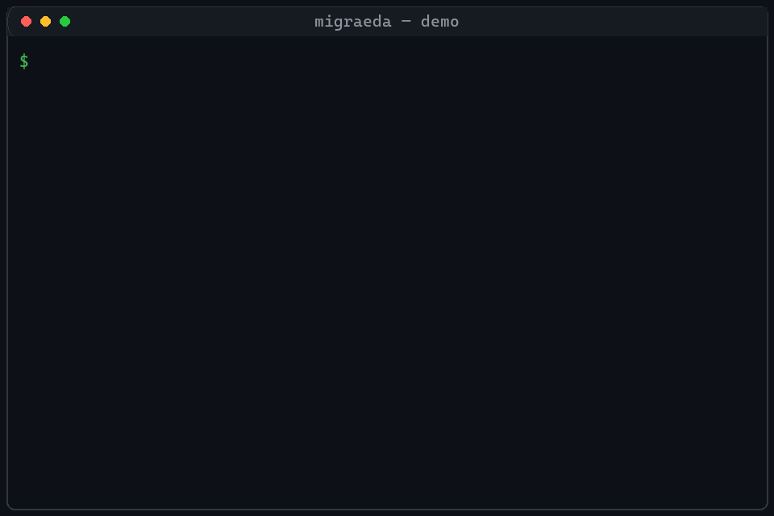

# MigraEDA

**嘉立创 EDA ↔ Altium Designer 双向转换 + 闭环校验：原理图逐引脚对网，PCB 连板框、走线、过孔、铜皮一起比对——哪里接错、哪里丢铜，转完当场列出来，而不是等打样回来才发现。**

[English](README.en.md)

<p align="center">
  <a href="LICENSE"></a>
  <a href="https://www.python.org/downloads/"></a>
  <a href="https://github.com/Apollo-lwx/MigraEDA/actions/workflows/ci.yml"></a>
  <a href="https://github.com/Apollo-lwx/MigraEDA"></a>
</p>

| | |
|---|---|
| 仓库 | [github.com/Apollo-lwx/MigraEDA](https://github.com/Apollo-lwx/MigraEDA) |
| 安装 | `pip install -e ".[dev]"`（Python 3.10+，运行时只依赖 olefile 一个纯 Python 小包） |
| 许可 | [MIT](LICENSE) |
| 当前版本 | 0.1.0 |

## 为什么需要它

嘉立创和 Altium 互转，官方导入导出转完都显示「成功」。但实际上：

- 符号变成方框
- 电源符号退化成普通网络
- 网络被悄悄改名
- 封装映射失败
- PCB 的走线、过孔、铺铜悄悄缺斤短两

**这些全都没有任何提示。** 一块 200 个元件的板子，没人真能开着两个 EDA 逐屏对完。于是调试口 GND 和 +5V 对调、保险丝从火线挪到零线、二极管画反——都是打样回来才发现的。

MigraEDA 的做法很直接：**写出文件后立刻读回来，自己跟自己比对。** 原理图按 `位号.引脚` 逐脚对网；PCB 先做刚体对齐，再比板框、元件布局、焊盘位置、过孔和每个网络的铜皮统计。对不上就逐条打印，退出码为 2，CI 直接拦住。原理图、PCB 和库都在校验范围内。

## 30 秒看效果



```bash
migraeda convert 板子.eprj --to ad
```

```text
direction: eprj -> ad-ascii-schdoc
written: .migraeda/板子.SchDoc
loop-verify: common_pins=367 mismatched=0 nets_matched=115
```

`mismatched=0` 表示这次转换在引脚连通上与源文件完全一致。有错位时会逐条打印出 `位号.引脚`，退出码为 2。

PCB 也一样，不只是「能打开」——走线、过孔、铺铜的数量和几何都会被核对：

```bash
migraeda convert 板子.eprj --to adpcb
```

```text
direction: eprj-pcb -> ad-ascii-pcbdoc
source: 203 components, 1420 pads, 3560 tracks, 412 vias, 28 pour polygons
written: .migraeda/板子.PcbDoc
fidelity-verify: PASS (pins 1420/1420, tracks 3560/3560, vias 412/412, polygons 28/28, geom PASS)
```

反过来，如果转换真的把网接错了——比如调试口的 GND 和 +5V 被对调——输出会是这样：

```text
loop-verify: common_pins=367 mismatched=2 nets_matched=115
  mismatch: J3.2 src='GND' out='+5V'
  mismatch: J3.3 src='+5V' out='GND'
```

退出码为 2。接在 CI 里，这一步直接挡住后续流程——错误的文件出不了流水线，也就到不了打样。

## 谁适合用

- 板子在嘉立创画的，但工厂 / 客户 / 同事要 Altium 文件（或反过来）
- 团队里嘉立创、Altium 混用，想确认两份文件是不是同一份设计
- 用了官方导入导出，想在交付前做一次独立核对
- 想把「转换有没有丢网」放进 CI，自动拦住而不是靠人对屏

## 和官方导入导出的区别

转换和验证在同一次命令里完成。产物用同一套解析器读回，原理图比对到引脚，PCB 比对到走线、过孔和铜皮，给出 PASS / WARN / FAIL。

| 能力 | 官方导入导出 | MigraEDA |
|------|----------------|----------|
| 转换结果 | 丢了也不提示 | 引脚级闭环验证，错位精确到 `位号.引脚` |
| 人工核对 | 开两个 EDA 对屏 | Markdown 报告，退出码 0 / 1 / 2 |
| 覆盖范围 | 多为原理图 | 原理图 + PCB（走线、过孔、铜皮）+ 库（符号、封装） |

## 核心特性

- **双向转换**：嘉立创 `.eprj` ↔ Altium `.SchDoc` / `.PcbDoc`，写出的 ASCII 文件 Altium Designer 可直接打开
- **原理图引脚级闭环验证**：转换产物立刻重解析，按 `位号.引脚` 逐脚对网，错位逐条打印
- **PCB 几何级闭环验证**：板框、元件布局、焊盘位置、过孔数量与位置、每个网络的走线长度与铜皮统计，先刚体对齐再比对，容差可调
- **三重独立验证**：转换内环、双文件比对、A→B→A' 往返比对
- **CI 友好**：退出码 PASS = 0 / WARN = 1 / FAIL = 2，报告是普通 Markdown，可直接归档为构建产物
- **零重型依赖、纯本地**：运行时只需 olefile 一个纯 Python 小包，没有账号、没有上传，设计文件不出本机
- **MCP 服务**：内置 stdio MCP server，可在 Cursor、WorkBuddy 里直接调用

## 支持的格式

| 格式 | 读 | 写 | 说明 |
|------|----|----|------|
| 嘉立创 `.eprj` | 原理图、PCB（docType=3）、内嵌库 | 原理图、PCB、库包 | SQLite 工程，解析不依赖官方客户端 |
| Altium `.SchDoc` | 二进制与 ASCII | ASCII | 多部件、多显示模式按当前部件/当前模式取引脚 |
| Altium `.PcbDoc` | 二进制与 ASCII | ASCII | 焊盘、过孔、走线、圆弧、铺铜、板框 |
| Altium `.SchLib` / `.PcbLib` | 可读，供 `libinspect` / `libdiff` / `libconvert` | 写出待真实样本校准后开放 | 库写出目前落在嘉立创侧 |
| 嘉立创专业版 `.epro` | 早期迁移检查 | — | 见下方「命令」里的 `.epro` 管道 |

写出的 `.SchDoc` / `.PcbDoc` 是 ASCII，Altium Designer 可以直接打开。二进制 PcbDoc 只读不写。

## 安装与快速开始

```bash
git clone https://github.com/Apollo-lwx/MigraEDA.git
cd MigraEDA
pip install -e ".[dev]"
pytest -q
```

设计文件放在 `samples/<项目名>/`，按扩展名识别。该目录已在 `.gitignore` 中，内容不会进仓库，约定见 [`samples/README.md`](samples/README.md)。所有命令也接受任意路径，`samples/` 只是方便批处理。

```bash
migraeda samples
```

```text
G318: AD PCB, AD原理图, 嘉立创工程
SME-IOT-1: AD PCB, AD原理图, 嘉立创工程
```

### 嘉立创工程转成 Altium

```bash
migraeda convert samples/G318/板子.eprj --to ad
```

不写 `-o` 时，产物写到源文件旁边的 `.migraeda/`（已在 `.gitignore` 里）。

```text
direction: eprj -> ad-ascii-schdoc
written: samples/G318/.migraeda/板子.SchDoc
loop-verify: common_pins=367 mismatched=0 nets_matched=115
```

PCB 用 `--to adpcb`。Altium 原理图转回嘉立创用 `--to eprj`。手边已有 Altium PCB 时，加上 `--with-pcb 板子.PcbDoc`，布局会写进新的 `.eprj`。多行拼板（仅 `adpcb`）用 `--panel-rows N`。

### 两份文件是不是同一份设计

```bash
migraeda verify samples/G318/嘉立创.eprj samples/G318/AD.SchDoc --report samples/G318/.migraeda/verify.md
```

```text
common pins: 351, mismatched: 34, nets matched: 110
```

差异写到位号、引脚和两侧网络名。PCB 对 PCB：

```bash
migraeda pcbdiff a.PcbDoc b.PcbDoc --tol 2.0 --report .migraeda/pcb.md
```

`.PcbDoc`（二进制或 ASCII）和带 PCB 页的 `.eprj` 可以混比。坐标系或拼板差异会先做刚体对齐，再比板框、元件、焊盘、过孔和铜皮。

### 官方导入之后，核对有没有丢网

在嘉立创客户端导入 Altium 并另存为 `.eprj` 之后：

```bash
migraeda verify 原始.SchDoc 导入后.eprj --report .migraeda/check.md
```

一条命令做原理图往返，并在工程里带 PCB 时把 PCB 往返一并跑完：

```bash
migraeda roundtrip samples/G318/板子.eprj
```

中间文件留在 `.migraeda/roundtrip/`。结论只有两种：

```text
roundtrip: IDENTICAL ✅
pcb roundtrip: PASS ✅
```

## 命令速查

转换默认带闭环验证。`--no-verify` 可以关掉。省略 `-o` 时，文件写到源文件旁边的 `.migraeda/`；`roundtrip` 写到 `.migraeda/roundtrip/`。

```bash
migraeda convert <输入> --to ad|eprj|adpcb [-o 目录] [--with-pcb PCBDOC] [--panel-rows N] [--report 报告.md]
migraeda libconvert <库源> [-o 目录]     # .eprj / .SchLib / .PcbLib / .PcbDoc → 嘉立创库包
```

| `--to` | 输入 | 产物 |
|--------|------|------|
| `ad` | `.eprj` | ASCII `.SchDoc` |
| `eprj` | `.SchDoc`（二进制或 ASCII） | 嘉立创 `.eprj` |
| `adpcb` | 含 PCB 页的 `.eprj` | ASCII `.PcbDoc` |

验证与往返：

```bash
migraeda verify <a> <b> [--report out.md] [--limit 30]
migraeda pcbdiff <a> <b> [--tol 2.0] [--report out.md]
migraeda libdiff <a> <b> [--tol 1.0] [--report out.md]
migraeda roundtrip <输入.eprj 或 .SchDoc> [-o 目录]
```

`<a>` / `<b>` 可以是 `.eprj`、`.SchDoc`、`.PcbDoc` 的任意组合（`pcbdiff` 的两侧须是 PCB：`.PcbDoc` 或含 PCB 的 `.eprj`）。退出码：PASS = 0，WARN = 1，FAIL = 2。原理图 `verify` 在出现引脚错位时返回 2。

辅助命令：

```bash
migraeda samples [--root samples] [--check]   # 列出样本；--check 逐个跑结构自检
migraeda libinspect <文件>                    # 只打印结构元数据，适合外发求助
migraeda selfcheck <文件> [--pcb] [--converted PCBDOC] [--report out.md]
migraeda fuzz <文件> [-n 50] [--seed 42]      # 变异输入，找解析器崩溃
```

`.epro` 早期管道（没有 KiCad 时 dry-run 仍可跑通）：

```bash
migraeda migrate <input.epro> -o <outdir> [--dry-run]
migraeda diff <source.epro> <kicad 或 stats.json> -o report.md
migraeda report <diff.json> -o report.md       # 加 --html 出 HTML
migraeda rollback <migration_id>
```

`diff` 的分级：元件数、网络名集合、过孔数一致为 PASS；元件数一致且网络对称差 ≤ 2 或过孔差为 1 时为 WARN；元件数不等、网络对称差 > 2 或过孔差 > 1 为 FAIL。

## 验证怎么成立

1. **内环。** 转换产物马上用同一套解析器读回，和源网表做引脚级 LVS，有错位就失败。
2. **外环。** 产物再和另一份已知设计（例如客户手上的原厂文件）比对。多出来的差异就是转换器的问题。旋转手性一类的错误是在这一层被收成零的。
3. **往返。** `A → B → A'`，终稿和原稿逐引脚比较。`roundtrip` 会把中间文件留在磁盘上。

PCB 侧用 `pcbdiff`：先做刚体对齐，吸收坐标系和拼板差异，再比板框尺寸、元件位置、焊盘偏移、过孔配对和逐网络铜皮统计（走线条数与总长、过孔数、铺铜）。`roundtrip` 在工程带 PCB 页时会自动把 PCB 往返一并跑完。

几何连通和这些规则对齐：导线端点与 T 型相接、零长度网络点、引脚直接对碰、多部件元件只激活当前部件的引脚、多显示模式取当前模式、Altium 网络名大小写不敏感、拼板实例先归并再比较。

## 已知边界

- 符号图形按引脚位置合成方框。引脚编号、位置和连通保持精确，原厂符号美术不在转换范围内。封装保留名称引用和焊盘几何。
- PCB 写出为 ASCII `.PcbDoc`。二进制 `.PcbDoc` 可以读、可以比，不能写回二进制。
- 库文件写出目前只到嘉立创 `.eprj` 库包。Altium `.SchLib` / `.PcbLib` 的写出要等真实样本校准。
- 生成的 `.eprj` 按已验证过的 schema 复刻，并用自带解析器回读。用嘉立创客户端打开时，请以你手上的客户端版本实测为准。
- `fixtures/golden/*.epro` 是合成 ZIP + JSON，字段名贴近公开资料，不是官方完整 schema。重建：`python scripts/build_fixtures.py`。

## 常见问题

<details>
<summary>嘉立创 <code>.eprj</code> 怎么转成 Altium <code>.SchDoc</code>？</summary>

```bash
migraeda convert 工程.eprj --to ad
```

输出是 ASCII `.SchDoc`，写在 `工程.eprj` 旁边的 `.migraeda/工程.SchDoc`，Altium Designer 可以直接打开。命令结束时会打印 `loop-verify`。`mismatched=0` 才算这轮引脚连通通过。

</details>

<details>
<summary>嘉立创 PCB 怎么转成 Altium <code>.PcbDoc</code>？</summary>

```bash
migraeda convert 工程.eprj --to adpcb
```

工程里需要有 PCB 页。输出包含焊盘、过孔、走线、圆弧、铺铜和板框，同样是 ASCII，Altium 可直接打开。

</details>

<details>
<summary>Altium 原理图怎么转回嘉立创？</summary>

```bash
migraeda convert 原理图.SchDoc --to eprj
migraeda convert 原理图.SchDoc --to eprj --with-pcb 板子.PcbDoc
```

二进制和 ASCII 的 `.SchDoc` 都能读。第二行把已有 PCB 嵌进新的 `.eprj`。

</details>

<details>
<summary>怎么确认转换没有把网络接错？</summary>

看三条独立的证据，由严到宽：`convert` 自带的 loop-verify、`migraeda verify` 对两份任意来源的文件、`migraeda roundtrip` 的往返自比对。三处都用同一套引脚级 LVS。引脚错位的退出码是 2，WARN 是 1，通过是 0。

</details>

<details>
<summary>和嘉立创官方的导入导出有什么不同？</summary>

官方路径负责把文件打开。MigraEDA 在写出之后重解析产物，把不一致的引脚打印出来，并用退出码挡住后续流程。官方导入完成之后，也可以用 `migraeda verify 原始文件 导入后.eprj` 做一次独立核对。

</details>

<details>
<summary>符号会变成方框吗？</summary>

会。转换后的符号是按引脚位置合成的方框，引脚编号、坐标和网络连通按 LVS 核对。原厂符号图形和封装丝印美术不在本工具的转换范围内。封装侧保留名称和焊盘几何。

</details>

<details>
<summary>能放进 CI 吗？</summary>

可以。安装只需 Python 3.10+，运行时依赖只有 olefile 一个纯 Python 小包。`mismatched` 非零或 PCB 分级为 FAIL 时退出码为 2。报告是普通 Markdown，可直接作为构建产物归档。

</details>

<details>
<summary>设计文件会离开本机吗？</summary>

不会。解析、转换、比对全部在本地完成，没有账号，也没有上传接口。产物默认在源文件旁的 `.migraeda/`，`samples/` 与 `.migraeda/` 都已被 git 忽略。需要对外求助时，用 `migraeda libinspect`，它只打印结构元数据。

</details>

<details>
<summary>支持 KiCad 吗？</summary>

主路径是嘉立创 `.eprj` 与 Altium。嘉立创专业版 `.epro` 仍保留早期的 `migrate` / `diff` / `report` / `rollback`，用于可复查的 KiCad 迁移检查；机器上没有 KiCad 时 `--dry-run` 可以跑完统计和报告。

</details>

## 参与贡献

问题请到 [GitHub Issues](https://github.com/Apollo-lwx/MigraEDA/issues) 提交。复现转换问题时，优先附上 `migraeda libinspect <文件>` 的输出和 `verify` / `pcbdiff` 的 Markdown 报告，不必附上整份原理图。

```bash
pip install -e ".[dev]"
pytest -q
```

## 本地 MCP

本机 stdio 服务，给 Cursor、WorkBuddy 这类客户端调用。设计文件只在运行这条命令的电脑上读写，没有远程接口。

```bash
pip install -e ".[mcp]"
```

`mcp.json`（Cursor 用项目或用户配置，WorkBuddy 用 `~/.workbuddy/mcp.json`）：

```json
{
  "mcpServers": {
    "migraeda": {
      "command": "python",
      "args": ["-m", "migraeda.mcp_server"]
    }
  }
}
```

虚拟环境里也可以把 `command` 写成 `migraeda-mcp`，去掉 `args`。

| 工具 | 作用 | 是否写文件 |
|------|------|------------|
| `migraeda_convert` | `.eprj` ↔ `.SchDoc` / `.PcbDoc`，带引脚级闭环验证 | 写到 `.migraeda/` |
| `migraeda_verify` | 两份设计的引脚网络比对 | 不写 |
| `migraeda_pcbdiff` | 两份 PCB 的板框、元件、焊盘、过孔、铜皮 | 不写 |
| `migraeda_roundtrip` | 转出再转回，和原稿比对；有 PCB 页时一并跑 | 写到 `.migraeda/roundtrip/` |
| `migraeda_libinspect` | 结构元数据，可外发求助 | 不写 |
| `migraeda_selfcheck` | 单份文件的悬空引脚、重复位号等信号 | 不写 |

返回里的错位列表默认最多 20 条。`grade` 为 `PASS`、`WARN`、`FAIL` 或 `SKIPPED`。大板把 `timeout_seconds` 调到 300 以内，上限 600。

## 许可

核心代码 [MIT](LICENSE)。Copyright (c) 2026 dan luo / MigraEDA contributors。

不要把 GPL 的 EasyKiConverter 静态链接进本项目。
